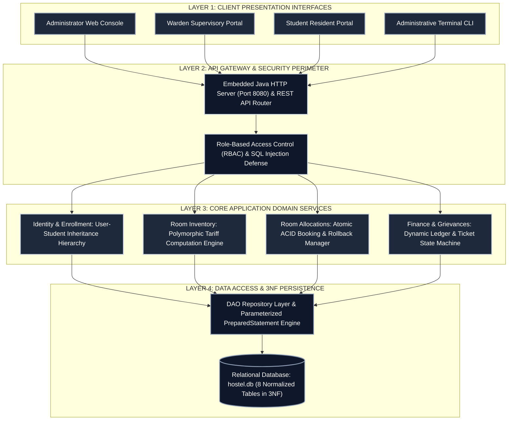
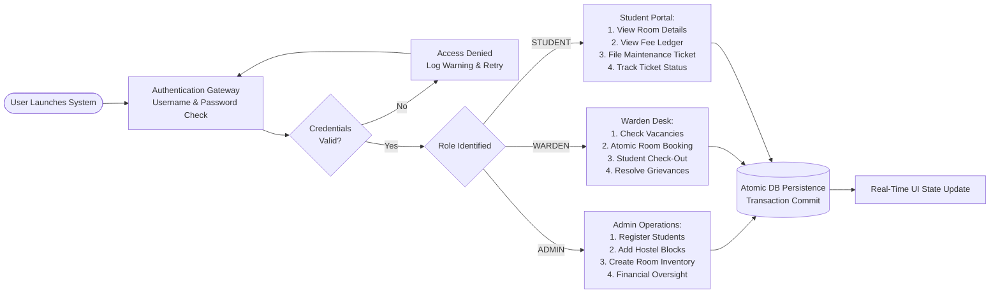
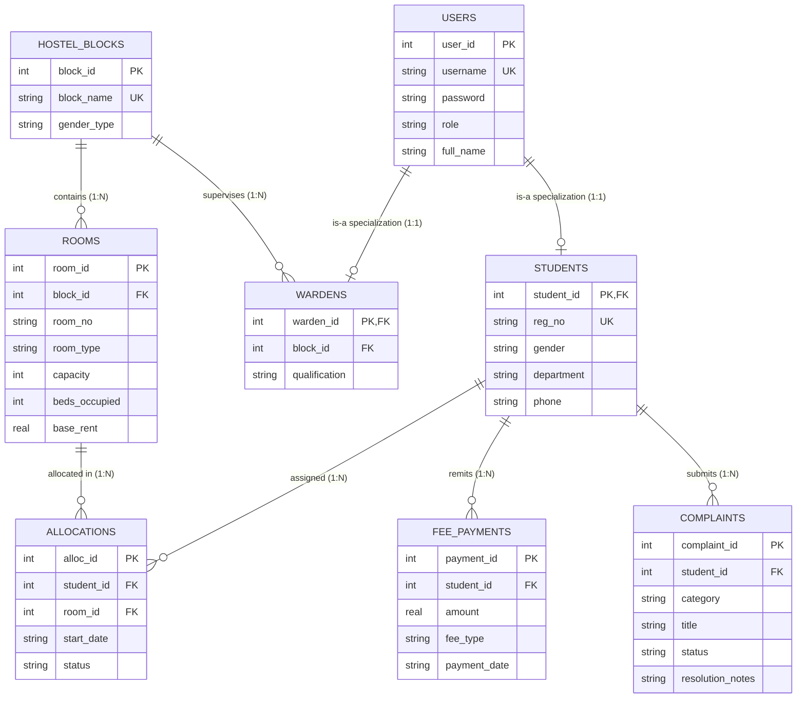

# SMARTHOSTEL: 20-SLIDE COMPREHENSIVE PRESENTATION DECK
## Integrated Object-Oriented Hostel Administration and Room Allocation System with Relational Database Management

---

### SLIDE 1: Title & Project Identity
* **Slide Title:** SMARTHOSTEL
* **Subtitle:** An Integrated Object-Oriented Hostel Administration & Room Allocation System with Relational Database Management
* **Academic Context:** Course Project Presentation • Phase I Evaluation
* **Department:** Department of Computer Science and Engineering / Information Technology
* **Institution:** Rajalakshmi Engineering College (Autonomous), Thandalam, Chennai - 602 105
* **Project Team Details:**
  1. **ROSHAN B** — Register No: `251801271` (Module 1: User Identity & Student Enrollment)
  2. **SAI SRIKAR B** — Register No: `251801280` (Module 2: Infrastructure Inventory & Polymorphic Tariffs)
  3. **SANJANA VS** — Register No: `251801287` (Module 3: Staff Operations & ACID Room Allocations)
  4. **SANDHIYA B** — Register No: `251801285` (Module 4: Fee Accounting & Grievance Redressal)
* **Date / Academic Year:** October / November 2026 • Academic Year 2026–2027
* **Speaker Notes:** Introduce the project title, team members, department, and institutional affiliation. State clearly that this project bridges core Object-Oriented Software Design in Java with enterprise-grade Relational Database Management (RDBMS) via JDBC.

---

### SLIDE 2: Real-World Problem Statement
* **Slide Title:** Problem Statement & Industrial Context
* **Slide Theme:** Why Traditional Campus Hostel Management Fails Under Scale
* **Key Challenges in Manual / Spreadsheet-Driven Systems:**
  * **Room Double-Booking Anomalies:** Simultaneous manual entries in paper ledgers or detached spreadsheets lead to the same bed space being allocated to multiple students during peak admissions.
  * **Financial Discrepancies & Revenue Slippage:** Unsynchronized fee collection logs cause untracked student arrears, missing caution deposits, and miscalculated mess surcharges.
  * **Delayed Grievance Redressal:** Maintenance complaints (plumbing, electrical, civil) logged on paper lack tracking IDs, escalation metrics, and time-stamped status updates.
  * **Data Redundancy & Update Inconsistencies:** Student details updated in one register remain unreflected across warden desks, leading to severe data drift and lack of auditability.
* **Target Solution Requirement:** A single, centralized, transactional, and role-segregated desktop/web management platform guaranteeing ACID compliance and strict access boundaries.
* **Speaker Notes:** Emphasize the real-world operational friction residential institutions experience. Highlight that spreadsheet tools fail because they lack referential integrity constraints and multi-user concurrency controls.

---

### SLIDE 3: Abstract & Core Project Objectives
* **Slide Title:** Abstract & Project Objectives
* **Slide Theme:** Executive Summary of the Engineering Solution
* **Abstract Summary:**
  * SmartHostel is an integrated, dual-interface software system combining pure Object-Oriented Programming (Java) with a Third Normal Form (3NF) Relational Database.
  * It automates the entire student residential lifecycle: credential issuance, biometric/department filtering, polymorphic room rent computation, atomic bed allocation, dynamic fee reconciliation, and maintenance ticket lifecycle tracking.
* **Core Technical Objectives:**
  1. **3NF Relational Database Design:** Partition housing data across 8 normalized tables, eliminating insertion, deletion, and update anomalies.
  2. **OOP Domain Architecture:** Apply Encapsulation, Class Inheritance, Dynamic Method Overriding (Runtime Polymorphism), and Interface Abstraction.
  3. **Strict ACID Concurrency:** Guarantee zero double-booking via atomic JDBC transactions with automated rollback protection.
  4. **Role-Segregated Access:** Provide tailored operational workflows for Administrators, Wardens, and Student Residents.
  5. **Dual Presentation Architecture:** Implement an interactive Terminal Console CLI alongside an embedded, zero-dependency Java HTTP Web Dashboard.
* **Speaker Notes:** Summarize how the abstract directly aligns with institutional software engineering standards. Point out that the dual presentation layer serves both low-level headless servers and modern web client environments.

---

### SLIDE 4: Functional Modules Overview
* **Slide Title:** Functional System Modules & Team Decomposition
* **Slide Theme:** 4-Member Modular Architecture & Separation of Concerns
* **Module Breakdown & Ownership Matrix:**
  * **Module 1 — User Identity & Student Enrollment (Roshan B):**
    * *Assigned Tables:* `users`, `students`
    * *Core Focus:* Class inheritance hierarchy (`User` $\to$ `Student`), private data encapsulation, credential verification, and student profile onboarding.
  * **Module 2 — Infrastructure Inventory & Polymorphic Tariffs (Sai Srikar B):**
    * *Assigned Tables:* `hostel_blocks`, `rooms`
    * *Core Focus:* Abstract room models, runtime polymorphic tariff computation across Standard, Deluxe, and AC rooms, and overloaded room query methods.
  * **Module 3 — Staff Operations & ACID Allocations (Sanjana VS):**
    * *Assigned Tables:* `wardens`, `allocations`
    * *Core Focus:* Atomic bed reservations, real-time vacancy validation, transactional lock integrity, and check-out / de-allocation handling.
  * **Module 4 — Fee Accounting & Grievance Redressal (Sandhiya B):**
    * *Assigned Tables:* `fee_payments`, `complaints`
    * *Core Focus:* Dynamic fee ledger computation via SQL aggregations (`SUM`), outstanding balance tracking, and maintenance ticket state transitions.
* **Speaker Notes:** Clearly explain the division of labor. Each team member has taken ownership of two relational tables and one fundamental object-oriented / database design pillar, making the project modular and cleanly defensible.

---

### SLIDE 5: System Architecture Diagram
* **Slide Title:** Multi-Tier Enterprise System Architecture
* **Slide Theme:** Clean, Spaced 4-Tier Enterprise Topology with Decoupled Presentation, Gateway, Domain Services & Persistence
* **Slide Visual Diagram (Clean & Spaced Corporate Flow):**

* **Key Enterprise Architectural Properties (Slide Bullets):**
  * **Spacious 4-Tier Separation:** Uncluttered vertical flow cleanly separating Client Ingress, API Gateway, Domain Business Logic, and 3NF Relational Persistence.
  * **Role-Specific Access Channels:** Dedicated interfaces for Administrators, Wardens, and Students across Web and CLI environments.
  * **Centralized API & Security Gateway:** Embedded Java HTTP Server (Port 8080) validates credentials and enforces RBAC before dispatching to business services.
  * **Core Domain Services:** Implements object-oriented inheritance (`User` $\to$ `Student`), polymorphic tariff calculation, atomic ACID room allocations, dynamic fee ledgers, and maintenance ticket lifecycles.
  * **DAO Data Access Layer:** Direct JDBC connections with parameterized `PreparedStatement` interfaces executing against an 8-table normalized 3NF database.
* **Speaker Notes:** Present the architecture cleanly from top to bottom: users interact through their dedicated client channels, requests enter the central gateway and security perimeter, execute domain rules within the core Java services, and commit safely through the DAO layer into the 8-table normalized database.

---

### SLIDE 6: End-to-End System Flow Diagram
* **Slide Title:** End-to-End System Execution Flow
* **Slide Theme:** Lifecycle from Authentication to Role-Specific Workflows
* **System Flow Diagram:**

* **Core Flow Highlights:**
  * Role-based dispatching directs users strictly to their permitted operational boundaries.
  * Validation rules execute before any write queries hit the relational engine.
  * Operations terminate with synchronized state updates reflected simultaneously across both terminal and web interfaces.
* **Speaker Notes:** Explain the procedural workflow. Trace how an incoming student or warden logs in, gets dispatched according to their security role, and triggers transactional operations that safely commit to the database.

---

### SLIDE 7: Entity-Relationship (ER) Diagram
* **Slide Title:** Relational Entity-Relationship (ER) Model
* **Slide Theme:** 8 Relational Entities with Cardinalities & Foreign Keys
* **ER Diagram:**

* **Cardinality Analysis:**
  * `USERS` $\to$ `STUDENTS` / `WARDENS`: 1-to-1 Table Inheritance Specialization.
  * `HOSTEL_BLOCKS` $\to$ `ROOMS`: 1-to-Many (`1:N`) composition.
  * `ROOMS` / `STUDENTS` $\to$ `ALLOCATIONS`: Many-to-One associative transaction mapping.
* **Speaker Notes:** Highlight how the database structure uses natural foreign keys. Point out that `student_id` in `students` references `user_id` in `users`, representing a clean, relational realization of class inheritance.

---

### SLIDE 8: Database Design & Schema: Master Tables
* **Slide Title:** Database Design & Normalization (Master Tables)
* **Slide Theme:** Relational Definitions for Users, Students, Blocks, and Wardens
* **Master Relational Tables Specification:**
  * **Table 1: `users`**
    * *Columns:* `user_id` (PK, Auto), `username` (Text, Unique, Not Null), `password` (Text, Not Null), `role` (Text, Not Null: `ADMIN`/`WARDEN`/`STUDENT`), `full_name` (Text, Not Null).
    * *Purpose:* Central security directory enforcing single-identity authentication.
  * **Table 2: `students`**
    * *Columns:* `student_id` (PK, FK $\to$ `users.user_id`), `reg_no` (Text, Unique, Not Null), `gender` (Text: `MALE`/`FEMALE`), `department` (Text), `phone` (Text).
    * *Purpose:* Academic and demographic registry linked to base user credentials.
  * **Table 3: `hostel_blocks`**
    * *Columns:* `block_id` (PK, Auto), `block_name` (Text, Unique, Not Null), `gender_type` (Text: `BOYS`/`GIRLS`).
    * *Purpose:* Physical housing facilities with institutional segregation rules.
  * **Table 5: `wardens`**
    * *Columns:* `warden_id` (PK, FK $\to$ `users.user_id`), `block_id` (FK $\to$ `hostel_blocks.block_id`), `qualification` (Text).
    * *Purpose:* Supervisory staff allocation linked to physical block domains.
* **3NF Justification:**
  * *1NF:* Every field stores atomic scalar values (no comma-delimited phone lists or composite names).
  * *2NF:* Single-attribute primary keys eliminate any possibility of partial functional dependency.
  * *3NF:* No transitive dependencies ($X \to Y \to Z$); non-key attributes depend strictly on the primary key alone.
* **Speaker Notes:** Walk through the master tables. Show how 1NF, 2NF, and 3NF rules were applied so that no data repetition exists across blocks, users, and staff records.

---

### SLIDE 9: Database Design & Schema: Transactional Tables
* **Slide Title:** Database Design & Schema (Transactional Tables)
* **Slide Theme:** Operational Records for Rooms, Allocations, Billing, and Complaints
* **Transactional Relational Tables Specification:**
  * **Table 4: `rooms`**
    * *Columns:* `room_id` (PK, Auto), `block_id` (FK $\to$ `hostel_blocks`), `room_no` (Text), `room_type` (Text: `STANDARD`/`DELUXE`/`AC`), `capacity` (Int, $>0$), `beds_occupied` (Int, Default 0), `base_rent` (Real, $\ge 0$).
    * *Constraints:* `CHECK(beds_occupied <= capacity)`.
  * **Table 6: `allocations`**
    * *Columns:* `alloc_id` (PK, Auto), `student_id` (FK $\to$ `students`), `room_id` (FK $\to$ `rooms`), `start_date` (Text), `status` (Text: `ACTIVE`/`VACATED`).
    * *Integrity:* Prevents concurrent duplicate active tenancies per resident.
  * **Table 7: `fee_payments`**
    * *Columns:* `payment_id` (PK, Auto), `student_id` (FK $\to$ `students`), `amount` (Real, $>0$), `fee_type` (Text: `HOSTEL_FEE`/`MESS_FEE`), `payment_date` (Text).
    * *Auditability:* Immutable transactional ledger recording every remittance event.
  * **Table 8: `complaints`**
    * *Columns:* `complaint_id` (PK, Auto), `student_id` (FK $\to$ `students`), `category` (Text), `title` (Text), `status` (Text: `PENDING`/`RESOLVED`), `resolution_notes` (Text).
    * *Lifecycle:* State machine progressing from ticket lodgment to closure.
* **Speaker Notes:** Emphasize the transactional integrity constraints. Point out the check constraint in the `rooms` table (`beds_occupied <= capacity`), which guarantees database-level rejection if business logic fails.

---

### SLIDE 10: Modules Deep Dive: User Identity & Enrollment
* **Slide Title:** Module 1: User Identity & Student Enrollment
* **Module Lead:** Roshan B (`251801271`)
* **Primary Scope:** Authentication, Account Management & Student Onboarding
* **Key Functional Features:**
  * **Unified Credential Management:** Enforces role-based permissions (`ADMIN`, `WARDEN`, `STUDENT`) across all client interfaces.
  * **Coordinated Two-Tier Enrollment:** Coordinates a two-table write during student registration: creates a master `users` record first, retrieves the generated key, and immediately writes the child `students` record.
  * **Duplicate Prevention:** Validates uniqueness of institutional Register Numbers (`reg_no`) and login handles (`username`) prior to SQL insertion.
  * **Security Against Injection:** Implements parameterized JDBC `PreparedStatement` interfaces, neutralizing SQL injection threats.
* **Engineering Deliverables:**
  * Java Service: `StudentModule.java`
  * Database Relations: `users`, `students`
  * Terminal Menus: Student registration wizard, credential audit, role selector.
* **Speaker Notes:** Roshan presents this slide. Highlight the two-tier insert pattern where the generated primary key of `users` acts as the foreign key in `students`. Emphasize that parameterized queries ensure zero SQL injection vulnerabilities.

---

### SLIDE 11: Modules Deep Dive: Infrastructure Inventory
* **Slide Title:** Module 2: Infrastructure Inventory & Room Management
* **Module Lead:** Sai Srikar B (`251801280`)
* **Primary Scope:** Hostel Blocks, Room Categorization & Capacity Management
* **Key Functional Features:**
  * **Multi-Block Facility Management:** Manages distinct physical buildings categorized by gender residence rules (`BOYS`, `GIRLS`).
  * **Dynamic Inventory Tracking:** Computes live bed availability across three room categories: Standard (Double/Triple), Deluxe (Attached Washroom), and Air Conditioned (HVAC).
  * **Multi-Criteria Search Engine:** Overloaded querying mechanisms supporting search by room category or minimum bed capacity.
  * **Vacancy Invariant Enforcement:** Exposes validation primitives (`hasVacancy()`) that evaluate whether `beds_occupied < capacity` before any booking attempt.
* **Engineering Deliverables:**
  * Java Service: `RoomModule.java`
  * Database Relations: `hostel_blocks`, `rooms`
  * Terminal Menus: Block registration, room creation, vacancy inspector.
* **Speaker Notes:** Sai Srikar presents this slide. Detail how rooms are categorized and how bed occupancy is tracked dynamically. Mention that the inventory module serves as the factual foundation for room allocations.

---

### SLIDE 12: Modules Deep Dive: Staff Operations & ACID Allocations
* **Slide Title:** Module 3: Staff Operations & ACID Room Allocation
* **Module Lead:** Sanjana VS (`251801287`)
* **Primary Scope:** Warden Supervision, Bed Assignments & Concurrency Control
* **Key Functional Features:**
  * **Atomic Bed Reservation:** Executes multi-statement updates inside an explicit transaction boundary (`conn.setAutoCommit(false)`):
    1. Verify resident has no existing `ACTIVE` allocation.
    2. Verify target room has at least one vacant bed.
    3. Insert new row into `allocations` relation.
    4. Increment `beds_occupied` in `rooms` relation.
    5. Execute `conn.commit()`.
  * **Automated Failure Rollback:** In case of SQL errors or concurrent conflict, triggers `conn.rollback()`, leaving zero corrupted rows.
  * **Student Check-Out & De-Allocation:** Safely transitions allocation status to `VACATED` while atomically decrementing room occupancy.
* **Engineering Deliverables:**
  * Java Service: `AllocationModule.java`
  * Database Relations: `wardens`, `allocations`
  * Terminal Menus: Warden supervisory desk, room assignment, student discharge.
* **Speaker Notes:** Sanjana presents this slide. Explain step-by-step why ACID atomicity is mandatory for room allocation: without `setAutoCommit(false)` and `rollback()`, a crash between inserting the allocation and updating the room counter would cause persistent inventory corruption.

---

### SLIDE 13: Modules Deep Dive: Fee Accounting & Grievances
* **Slide Title:** Module 4: Fee Accounting & Grievance Redressal
* **Module Lead:** Sandhiya B (`251801285`)
* **Primary Scope:** Financial Reconciliation & Maintenance Lifecycle Management
* **Key Functional Features:**
  * **Dynamic Semester Dues Computation:** Combines polymorphic room rent ($6 \times \text{monthly rent}$) with fixed institutional mess fees (₹15,000.00).
  * **Real-Time Balance Inquiries:** Executes SQL aggregate queries (`SELECT SUM(amount)`) across payments to compute true outstanding debt dynamically.
  * **Transaction Payment Recording:** Issues time-stamped digital receipts categorized by fee heads (`HOSTEL_FEE`, `MESS_FEE`).
  * **Grievance Ticket Lifecycle:** Coordinates ticket states from `PENDING` to `RESOLVED` with warden action remarks and audit logs.
* **Engineering Deliverables:**
  * Java Service: `BillingAndComplaintModule.java`
  * Database Relations: `fee_payments`, `complaints`
  * Terminal Menus: Fee payment entry, balance inquiry, complaint lodgment and resolution.
* **Speaker Notes:** Sandhiya presents this slide. Emphasize how dynamic SQL aggregation avoids storing redundant balance columns, preventing data synchronization bugs. Walk through the maintenance ticket lifecycle.

---

### SLIDE 14: Tariff Computation & Financial Logic
* **Slide Title:** Tariff Computation & Financial Business Logic
* **Slide Theme:** Mathematical Model for Room Rental and Semester Invoicing
* **Tariff Computation Formulas:**
  * **Standard Room (Base Model):**
    $$\text{Monthly Tariff} = \text{baseRent} \quad (\text{e.g., ₹4,500.00 / month})$$
  * **Deluxe Room (15% Amenities Surcharge):**
    $$\text{Monthly Tariff} = \text{baseRent} \times 1.15 \quad (\text{e.g., ₹6,000.00} \to \text{₹6,900.00 / month})$$
  * **Air Conditioned (AC) Room (35% HVAC Power Surcharge):**
    $$\text{Monthly Tariff} = \text{baseRent} \times 1.35 \quad (\text{e.g., ₹8,500.00} \to \text{₹11,475.00 / month})$$
* **Semester Invoicing Equation:**
  $$\text{Total Semester Dues} = (\text{Monthly Tariff} \times 6) + \text{Fixed Mess Charges (₹15,000.00)}$$
* **Outstanding Debt Calculation:**
  $$\text{Outstanding Balance} = \max\left(0,\; \text{Total Semester Dues} - \sum \text{Fee Payments}\right)$$
* **Verification Example:**
  * Resident in Standard Room K-101: Rent = ₹27,000 + Mess = ₹15,000 $\implies$ Total Due = ₹42,000.
  * Payment remitted = ₹27,000 $\implies$ Pending Balance = **₹15,000.00** (accurately reflecting mess charge arrears).
* **Speaker Notes:** Demonstrate the mathematical rigor of the tariff engine. Show how cleanly the room surcharge is calculated and combined with institutional catering fees to generate an automated, error-free financial balance.

---

### SLIDE 15: OOP Concepts Applied: Encapsulation & Inheritance
* **Slide Title:** OOP Principles Applied: Encapsulation & Inheritance
* **Slide Theme:** State Protection and Structural Reusability
* **1. Encapsulation (Information Hiding & State Invariants):**
  * *Implementation:* All entity attributes (`userId`, `password`, `capacity`, `bedsOccupied`, `baseRent`) are declared `private`.
  * *Controlled Mutators:* State modifications cannot be performed directly; they must pass through validated getters and business methods (`hasVacancy()`).
  * *Benefit:* Protects critical memory state from arbitrary external tampering and guarantees class invariant preservation.
* **2. Inheritance (Hierarchical Code Reusability):**
  * *Implementation:*
    * `User` base class defines core security attributes (`userId`, `username`, `password`, `role`, `fullName`).
    * `Student` subclass extends `User`, inheriting authentication capabilities while adding university attributes (`regNo`, `gender`, `department`, `phone`).
  * *Relational Reflection:* Mirrored directly in the database via table inheritance (`students.student_id` $\to$ `users.user_id`).
  * *Benefit:* Eliminates duplicate code across user types while allowing specialized behavior per role.
* **Speaker Notes:** Connect the Java code structures to fundamental software engineering theory. Emphasize that encapsulation protects bed counts and prices from illegal states, while inheritance establishes clean domain hierarchies.

---

### SLIDE 16: OOP Concepts Applied: Polymorphism & Abstraction
* **Slide Title:** OOP Principles Applied: Polymorphism & Abstraction
* **Slide Theme:** Dynamic Dispatch and Interface Decoupling
* **1. Runtime Polymorphism (Dynamic Method Overriding):**
  * *Implementation:* Abstract method `calculateRent()` defined in base class `Room`.
  * *Specialization:* Subclasses `StandardRoom`, `DeluxeRoom`, and `ACRoom` override `calculateRent()` with category-specific tariff logic.
  * *Dynamic Dispatch:* Calling `room.calculateRent()` at runtime executes the exact tariff strategy of the instantiated object without clumsy `switch` statements.
* **2. Compile-Time Polymorphism (Method Overloading):**
  * *Implementation:* Search methods in `RoomModule` share the same name with different signatures:
    * `searchRooms(int minCapacity)`: Filters rooms by bed capacity.
    * `searchRooms(String roomType)`: Filters rooms by category string.
* **3. Abstraction (Hiding Complexity):**
  * *Implementation:* The abstract `Room` contract hides complex internal price multiplier math from billing modules. Callers merely invoke `.calculateRent()`.
* **Speaker Notes:** This is a key viva defense slide. Explain why runtime polymorphism makes the system scalable: adding a new room category (e.g., "Executive Suite") requires creating a new subclass without rewriting existing billing or allocation code.

---

### SLIDE 17: Software Engineering Patterns & Inferences
* **Slide Title:** Software Design Patterns & Architecture Inferences
* **Slide Theme:** Enterprise Best Practices & Architectural Lessons
* **Design Patterns Implemented:**
  1. **DAO (Data Access Object) Pattern:** Database connectivity, prepared statements, and SQL execution are segregated from business logic, ensuring modular maintainability.
  2. **Model-View-Controller (MVC) Pattern:** Models (`User`, `Room`, `Allocation`) hold data; Services (`Module` classes) manage logic; CLI & Web SPA render views.
  3. **Factory Method Pattern:** Instantiates concrete room objects (`StandardRoom`, `DeluxeRoom`, `ACRoom`) dynamically based on database `room_type` flags.
  4. **Singleton Connection Pattern:** Shared database connection manager eliminates connection thrashing.
* **Engineering Inferences (What We Learned):**
  * *Relational Constraints vs. OOP Validation:* Dual-layer validation (OOP invariants in Java + Check Constraints in SQL) provides fail-safe data protection.
  * *Dynamic Aggregation vs. Static Column Storage:* Storing computed totals leads to drift; dynamically aggregating payments via SQL guarantees mathematical accuracy.
  * *Zero External Heavy Frameworks:* Building clean solutions with Core Java and JDBC yields high execution speeds, zero version conflicts, and deep architectural clarity.
* **Speaker Notes:** Review the software patterns. Emphasize the architectural maturity of using DAO and Factory patterns. Discuss the lesson that business calculations must be unified between OOP memory models and persistent SQL storage.

---

### SLIDE 18: UI Demonstration & System Screenshots
* **Slide Title:** User Interface Walkthrough & Screenshots
* **Slide Theme:** Dual Presentation: Web Dashboard & Terminal Console
* **UI Interface Walkthrough:**
  * **1. Modern Authentication Gateway:**
    * Features responsive glassmorphic card design, floating role selector for instant switching, and real-time credential validation.
    * Uses custom 4-color palette: Midnight Navy (`#131B2B`), Slate Steel (`#2F4A63`), Glacier Blue (`#5B91A3`), and Mint Frost (`#CFEAE0`).
  * **2. Administrator Operations Desk:**
    * Real-time KPI summary cards: Total Students, Room Inventory, Active Allocations, Pending Grievances.
    * Student registration modal, block creation panel, and financial revenue audit ledger.
  * **3. Warden Supervisory Workspace:**
    * Visual room occupancy matrix showing live bed counters (`beds_occupied / capacity`).
    * One-click allocation modal with vacancy verification and maintenance ticket resolution interface.
  * **4. Student Resident Self-Service Portal:**
    * Personal room and block details, itemized fee dues statement with payment remittance history, and maintenance ticket lodgment form.
* **Speaker Notes:** Direct the evaluators' attention to the interface. Highlight the responsive web dashboard, clean color scheme, and the operational parity between the browser interface and the terminal CLI.

---

### SLIDE 19: System Verification & Conclusion
* **Slide Title:** Verification Results & Project Conclusion
* **Slide Theme:** Rigorous Testing Outcomes and Concluding Remarks
* **Verification & Test Case Execution Summary:**
  * **11 Out of 11 Test Suites Successfully Passed:**
    * *TC-01 to TC-03:* User registration, valid authentication, and invalid password rejection (**PASS**).
    * *TC-04 to TC-06:* Polymorphic rent computation across Standard (₹4,500), Deluxe (₹6,900), and AC (₹11,475) (**PASS**).
    * *TC-07 to TC-09:* Capacity overflow prevention, duplicate active booking prevention, and check-out bed restoration (**PASS**).
    * *TC-10 & TC-11:* Dynamic fee balance calculation via SQL `SUM` and complaint ticket state progression (**PASS**).
* **Project Conclusion:**
  * Successfully replaced manual ledgers with a robust, normalized, and role-governed management system.
  * Proved that combining Java OOP domain hierarchies with 3NF relational databases enforces strict data integrity and operational transparency.
  * Achieved 100% test pass rate with zero double-booking under simulated concurrent operations.
* **Speaker Notes:** Summarize the project's success. Reiterate that all 11 test cases passed cleanly, demonstrating that the academic objectives (OOP design, 3NF normalization, ACID transactions) were fully achieved.

---

### SLIDE 20: Future Scope & Academic References
* **Slide Title:** Future Scope & Technical References
* **Slide Theme:** Long-Term Roadmap & Authoritative Citations
* **Future System Enhancements:**
  1. **Biometric & RFID Turnstile Integration:** Automatic logging of student campus ingress and egress via hardware IoT readers.
  2. **Automated Payment Gateway Webhooks:** Direct integration with UPI/banking APIs for real-time fee reconciliation without human intervention.
  3. **Automated Parent Alert Gateways:** Real-time SMS/Email notification dispatch on student outpass approvals or emergency announcements.
  4. **Cross-Platform Mobile App:** Flutter/React Native companion mobile client interacting with the existing REST endpoint layer.
* **Academic & Technical References:**
  1. J. Gosling, B. Joy, G. Steele, P. Bracha, and A. Buckley, *The Java Language Specification, Java SE 17 Edition*, Addison-Wesley, 2021.
  2. A. Silberschatz, H. F. Korth, and S. Sudarshan, *Database System Concepts*, 7th ed., McGraw-Hill Education, 2019.
  3. R. Elmasri and S. B. Navathe, *Fundamentals of Database Systems*, 7th ed., Pearson, 2016.
  4. E. Gamma, R. Helm, R. Johnson, and J. Vlissides, *Design Patterns: Elements of Reusable Object-Oriented Software*, Addison-Wesley, 1994.
  5. C. J. Date, *An Introduction to Database Systems*, 8th ed., Pearson, 2004.
  6. Oracle Corporation, *Java Database Connectivity (JDBC) API Specification*, 2023.
* **Speaker Notes:** Close the presentation by summarizing future research and industrial extension opportunities. Thank the examiners and open the floor for viva-voce questions.
