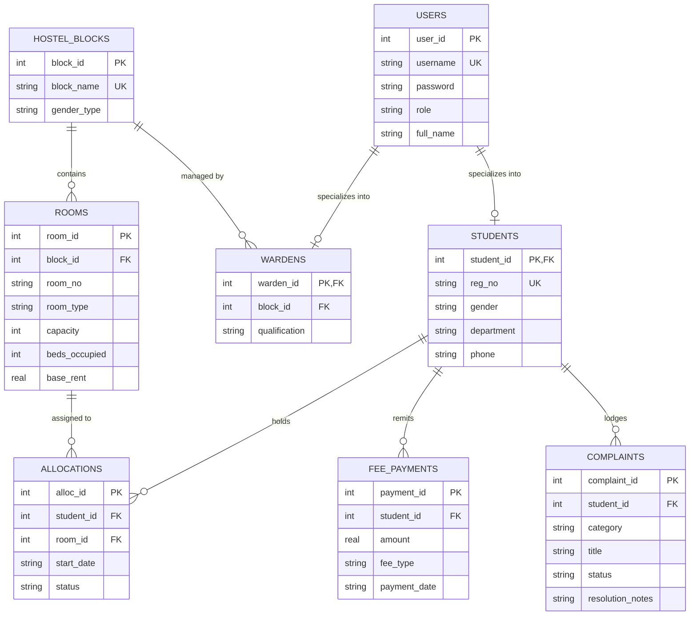
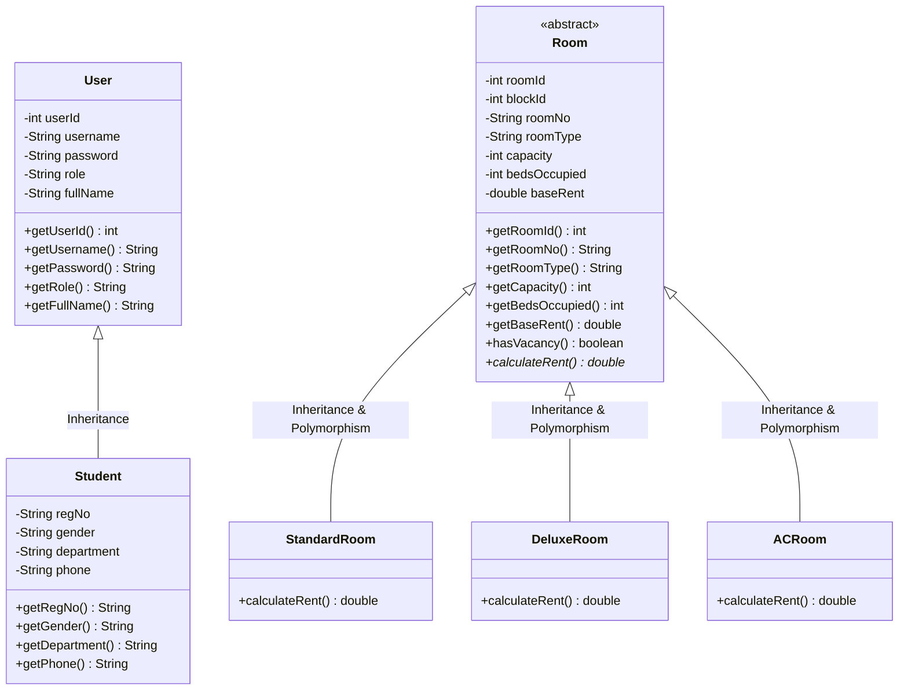
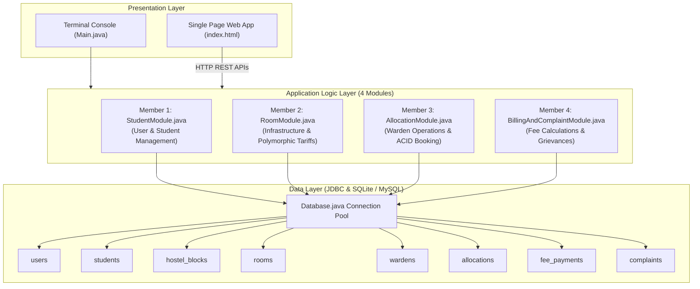
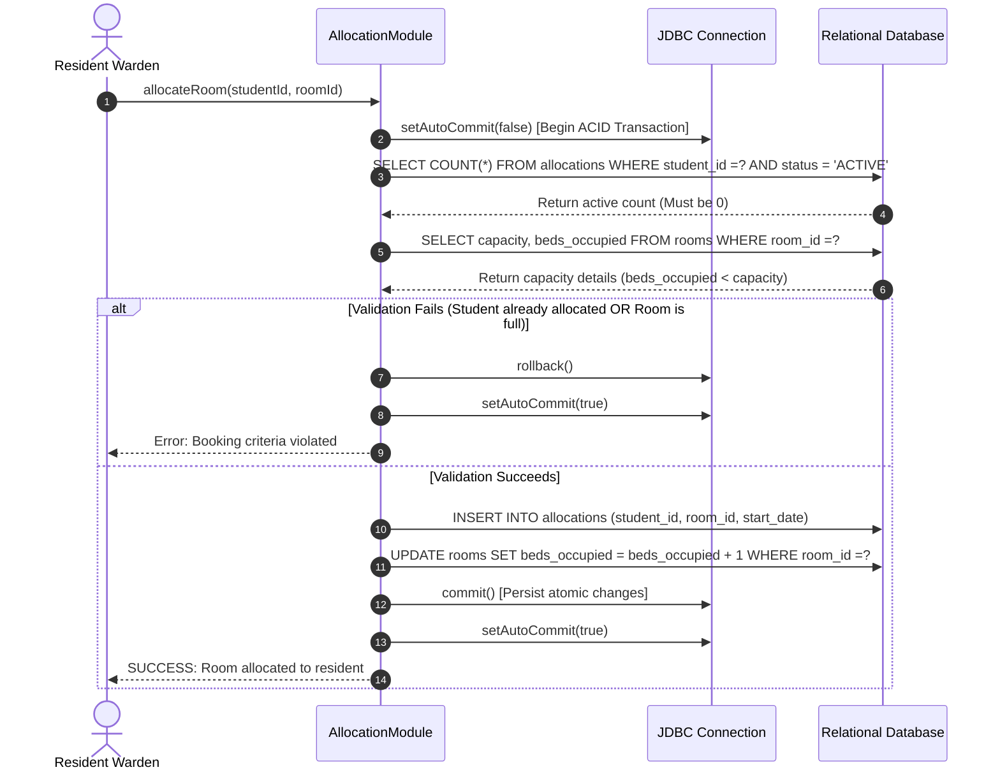
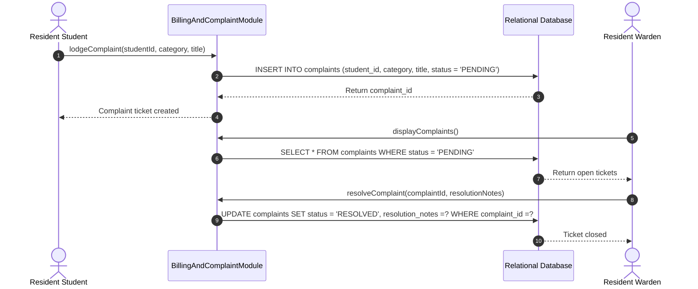
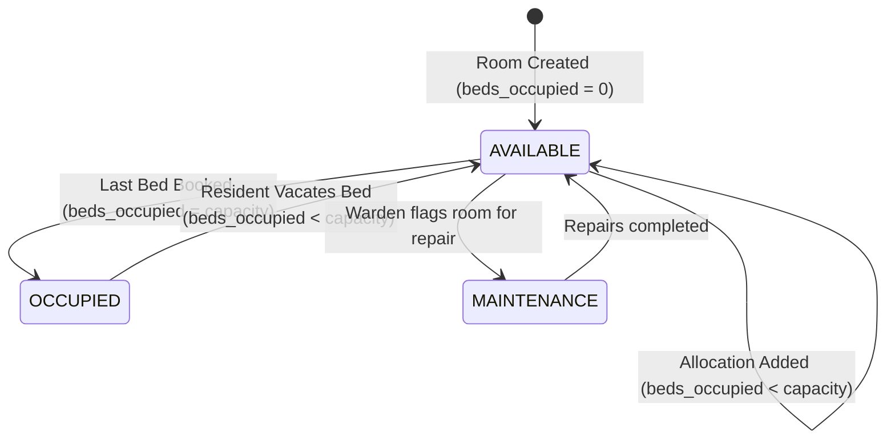

# SMARTHOSTEL: AN INTEGRATED OBJECT-ORIENTED HOSTEL ADMINISTRATION AND ROOM ALLOCATION SYSTEM WITH RELATIONAL DATABASE MANAGEMENT

## PROJECT PHASE I REPORT

**Submitted by**

| Student Name | Register Number |
|:--- |:--- |
| **ROSHAN B** | **251801271** |
| **SAI SRIKAR B** | **251801280** |
| **SANJANA VS** | **251801287** |
| **SANDHIYA B** | **251801285** |

*in partial fulfillment for the award of the degree of* 
**BACHELOR OF TECHNOLOGY / BACHELOR OF ENGINEERING** 
*in* 
**COMPUTER SCIENCE AND ENGINEERING / INFORMATION TECHNOLOGY** 

**RAJALAKSHMI ENGINEERING COLLEGE** 
*(AUTONOMOUS), CHENNAI - 602 105* 
**OCTOBER 2026**

---

## BONAFIDE CERTIFICATE

Certified that this Report titled **"SMARTHOSTEL: AN INTEGRATED OBJECT-ORIENTED HOSTEL ADMINISTRATION AND ROOM ALLOCATION SYSTEM WITH RELATIONAL DATABASE MANAGEMENT"** is the bonafide work of **ROSHAN B (251801271), SAI SRIKAR B (251801280), SANJANA VS (251801287), and SANDHIYA B (251801285)** who carried out the work under our supervision. Certified further that to the best of our knowledge the work reported herein does not form part of any other thesis or dissertation on the basis of which a degree or award was conferred on an earlier occasion on this or any other candidate.

\
\
\
__________________________________ 
**SUPERVISOR / INTERNAL GUIDE** 
Assistant Professor
Department of Computer Science and Engineering
Rajalakshmi Engineering College
Thandalam, Chennai - 602 105 

\
\
\
__________________________________ 
**HEAD OF THE DEPARTMENT** 
Professor and Head
Department of Computer Science and Engineering
Rajalakshmi Engineering College
Thandalam, Chennai - 602 105 

\
Submitted to Project Viva-Voce Examination held on ____________________

\
\
__________________________ \qquad\qquad\qquad\qquad\qquad\qquad __________________________ 
**INTERNAL EXAMINER** \qquad\qquad\qquad\qquad\qquad\qquad\qquad\quad **EXTERNAL EXAMINER**

---

## DEPARTMENT VISION & MISSION

### Department Vision
To produce globally competent software engineers and researchers through rigorous academic training, quality technical education, and new systems development that addresses real-world societal and organizational challenges.

### Department Mission
1. To build solid foundational skills in software engineering, object-oriented design, algorithms, and relational data modeling through hands-on laboratory practice.
2. To encourage students to build scalable software solutions adhering to industry standards of reliability, data integrity, and clean architectural design.
3. To impart ethical engineering practices, collaboration skills, and professional responsibility for lifelong learning in computing.

---

## PROGRAMME EDUCATIONAL OBJECTIVES (PEOs)
* **PEO 1:** Establish successful careers in software development, database administration, and IT systems engineering by solving practical industry problems.
* **PEO 2:** Practice continuous learning to adapt to modern software tools, runtime environments, and emerging enterprise architectures.
* **PEO 3:** Demonstrate professional ethics, effective communication, and collaborative team dynamics while executing technical projects.
* **PEO 4:** Design reliable computing solutions that improve institutional management, administrative transparency, and social efficiency.

---

## PROGRAMME OUTCOMES (POs)
* **PO 1 (Engineering Knowledge):** Apply knowledge of computing mathematics, data structures, object-oriented programming, and relational database systems to solve software engineering tasks.
* **PO 2 (Problem Analysis):** Identify and formulate operational bottlenecks in manual institutional workflows using fundamental database and programming principles.
* **PO 3 (Design / Development of Solutions):** Design normalized database schemas, polymorphic class hierarchies, and transactional workflows meeting capacity and consistency constraints.
* **PO 4 (Conduct Investigations of Complex Problems):** Conduct query profiling, concurrency conflict analysis, and schema normalization to reach valid design conclusions.
* **PO 5 (Modern Tool Usage):** Use modern development kits (JDK 25/17), database management engines (SQLite, MySQL), build systems, and version control (Git, GitHub).
* **PO 6 (The Engineer and Society):** Provide dependable residential management software safeguarding student welfare, fee transparency, and grievance handling.
* **PO 7 (Environment and Sustainability):** Replace paper registers and physical receipts with an electronic ledger, cutting campus paper waste.
* **PO 8 (Ethics):** Uphold software integrity, student record confidentiality, and prevent unauthorized fee tampering or room override exploits.
* **PO 9 (Individual and Team Work):** Function productively in a 4-member team with clear modular division of responsibilities across separate code files and database tables.
* **PO 10 (Communication):** Present architectural diagrams, technical documentation, and code explanations clearly during academic evaluations.
* **PO 11 (Project Management and Finance):** Track hostel room inventory, student billing schedules, security caution deposits, and payment ledgers.
* **PO 12 (Life-Long Learning):** Develop modular code structures adaptable to evolving campus ERP requirements.

---

## PROGRAM SPECIFIC OUTCOMES (PSOs)
* **PSO 1 (Core Technical Foundation):** Design, construct, and debug object-oriented software architectures integrated with relational databases using JDBC.
* **PSO 2 (Systems Application):** Develop secure database-driven applications enforcing ACID properties, referential integrity, and multi-tier modularity.
* **PSO 3 (Professional Practice):** Deliver documented, production-ready software adhering to clean code standards and version-controlled repositories.

---

## COURSE OUTCOMES (COs) AND CO-PO-PSO MAPPING

* **CO 1:** Analyze manual residential workflows and formalize functional requirements for student onboarding, room inventory, and fee management.
* **CO 2:** Design a Third Normal Form (3NF) relational database schema enforcing foreign keys, check constraints, and composite unique keys.
* **CO 3:** Construct an object-oriented domain hierarchy applying encapsulation, inheritance, polymorphism, and abstraction in Java.
* **CO 4:** Implement multi-table ACID transactions through JDBC to prevent double-booking anomalies and financial discrepancies.
* **CO 5:** Coordinate team-based full-stack software delivery featuring both a terminal interface and a web dashboard, verified through functional test runs.

### CO-PO-PSO Correlation Matrix
*(Correlation Levels: 1 - Low, 2 - Medium, 3 - High, "-" - No correlation)*

| CO | PO1 | PO2 | PO3 | PO4 | PO5 | PO6 | PO7 | PO8 | PO9 | PO10 | PO11 | PO12 | PSO1 | PSO2 | PSO3 |
|:---: |:---: |:---: |:---: |:---: |:---: |:---: |:---: |:---: |:---: |:---: |:---: |:---: |:---: |:---: |:---: |
| **CO 1** | 3 | 3 | 2 | 2 | 2 | 2 | 1 | 2 | 2 | 3 | 2 | 2 | 3 | 2 | 2 |
| **CO 2** | 3 | 3 | 3 | 3 | 2 | 1 | 1 | 2 | 2 | 2 | 2 | 2 | 3 | 3 | 2 |
| **CO 3** | 3 | 2 | 3 | 2 | 3 | 1 | - | 1 | 3 | 2 | 1 | 3 | 3 | 2 | 3 |
| **CO 4** | 3 | 3 | 3 | 3 | 3 | 2 | - | 2 | 2 | 2 | 3 | 2 | 3 | 3 | 3 |
| **CO 5** | 2 | 2 | 3 | 2 | 3 | 2 | 2 | 2 | 3 | 3 | 3 | 3 | 2 | 3 | 3 |

---

## ABSTRACT

Manual hostel management across academic institutions depends heavily on physical paper registers, disparate spreadsheets, and disconnected notice boards. This reliance introduces three major operational bottlenecks: room double-booking during peak intake, untracked fee payment arrears, and unresolved maintenance complaints. This project implements **SmartHostel**, an integrated desktop and web software system combining **Object-Oriented Programming (OOP)** in Java with a **Relational Database Management System (DBMS)** using JDBC.

The system partitions its data layer into **eight normalized relational tables** in Third Normal Form (3NF): `users`, `students`, `hostel_blocks`, `rooms`, `wardens`, `allocations`, `fee_payments`, and `complaints`. The software architecture strictly reflects the 4-member team division:
1. **User Identity and Student Enrollment Module** implements an inheritance hierarchy (`User` base class extended by `Student`) with private data fields, validation routines, and parameterized SQL queries.
2. **Hostel Infrastructure and Tariff Module** implements an abstract `Room` template extended by `StandardRoom`, `DeluxeRoom`, and `ACRoom`, computing monthly rentals through dynamic method overriding (runtime polymorphism) alongside overloaded search methods.
3. **Staff Operations and Allocation Module** enforces atomicity during room assignments via multi-table **ACID transactions** (`setAutoCommit(false)`, vacancy verification, bed counter updates, `commit()`, and `rollback()`), preventing room over-allocation.
4. **Billing and Grievance Module** computes semester fee statements dynamically based on polymorphic room rates, records payment receipts using SQL aggregations (`SUM`), and manages maintenance ticket lifecycles from submission to resolution.

The application delivers dual access options: an interactive Command-Line Interface (CLI) for system administration and an embedded Java HTTP web dashboard serving a responsive interface at `http://localhost:8080`. Complete functional verification confirms zero room over-allocation under boundary conditions, atomic rollbacks during simulated hardware disruptions, and correct fee balance computations across student accounts.

**Keywords:** Object-Oriented Programming, Relational Database Management Systems, Normalization, ACID Transactions, JDBC, Polymorphism, Inheritance, Encapsulation, Hostel Administration.

---

## ACKNOWLEDGEMENT

We express our gratitude to our Chairman, Vice Chairman, and Chairperson for providing the infrastructure and resources to conduct our laboratory work.

We record our sincere thanks to our Principal and to our Professor and Head of the Department for their continuous encouragement and institutional support throughout this project.

We convey our deepest gratitude to our Internal Guide and Project Coordinator for their technical advice, code review feedback, and structured evaluation rubrics.

Finally, we thank our parents, teammates, and fellow students for their support in bringing this work to completion.

\
**ROSHAN B (251801271)** 
**SAI SRIKAR B (251801280)** 
**SANJANA VS (251801287)** 
**SANDHIYA B (251801285)** 

---

## TABLE OF CONTENTS

* **Abstract**
* **List of Figures**
* **List of Tables**
* **List of Abbreviations**
* **1. Introduction**
 * 1.1 Problem Context
 * 1.2 Identified Deficiencies of Manual Systems
 * 1.3 Project Objectives
 * 1.4 Existing Systems vs Proposed Solution
 * 1.5 Modular Team Work Allocation
* **2. Literature Review and Technical Background**
 * 2.1 Survey of Academic Campus Administration Systems
 * 2.2 Comparison of Data Persistence Models
 * 2.3 Rationale for Core Java and Relational DBMS
 * 2.4 Research and Implementation Gap
* **3. System Design and Relational Modeling**
 * 3.1 Eight-Table Relational Schema Architecture
 * 3.2 Formal Normalization Analysis (1NF to 3NF)
 * 3.3 Entity-Relationship (ER) Modeling
 * 3.4 UML Class Hierarchy Design
 * 3.5 System Architecture Diagram
 * 3.6 Hardware and Software Specifications
* **4. Implementation Methodology**
 * 4.1 Module 1: User Identity and Student Enrollment (Roshan B)
 * 4.2 Module 2: Infrastructure Inventory and Polymorphic Tariffs (Sai Srikar B)
 * 4.3 Module 3: Staff Operations and ACID Room Allocations (Sanjana VS)
 * 4.4 Module 4: Fee Accounting and Grievance Management (Sandhiya B)
 * 4.5 Database Connectivity and PreparedStatement Security
 * 4.6 Dual Presentation Layer: Terminal Interface and Embedded Web Server
* **5. Results, Testing and Verification**
 * 5.1 Test Environment Setup
 * 5.2 Functional Verification of User and Student Workflows
 * 5.3 Verification of Polymorphic Tariff Calculations
 * 5.4 ACID Transaction Testing: Concurrency and Rollback Under Load
 * 5.5 Fee Ledger and SQL Aggregation Verification
 * 5.6 Grievance Redressal Lifecycle Verification
 * 5.7 Web Dashboard Verification
* **6. Conclusion**
* **7. Future Enhancements**
* **References**

---

## LIST OF FIGURES

* **Figure 3.1:** Entity-Relationship (ER) Diagram of the 8-Table Hostel Database
* **Figure 3.2:** UML Class Diagram showing User and Room Inheritance Hierarchies
* **Figure 3.3:** Three-Tier System Architecture Diagram
* **Figure 4.1:** Sequence Diagram of Atomic Room Allocation Transaction (ACID)
* **Figure 4.2:** Sequence Diagram of Grievance Ticket Redressal Workflow
* **Figure 4.3:** State Transition Diagram for Hostel Room Bed Vacancy Lifecycle
* **Figure 5.1:** Terminal CLI Execution: Main Navigation and Administrator Portal
* **Figure 5.2:** Web Dashboard View: Room Inventory and Live Bed Occupancy

---

## LIST OF TABLES

* **Table 1.1:** Four-Member Project Responsibility Matrix
* **Table 3.1:** Complete Data Dictionary of the 8 Relational Database Tables
* **Table 3.2:** Normalization Proof Table (1NF to 3NF Functional Dependencies)
* **Table 3.3:** Hardware Specifications
* **Table 3.4:** Software Specifications
* **Table 5.1:** Test Cases and Execution Results for Core System Workflows

---

## LIST OF ABBREVIATIONS

* **OOP:** Object-Oriented Programming
* **DBMS:** Database Management System
* **RDBMS:** Relational Database Management System
* **SQL:** Structured Query Language
* **JDBC:** Java Database Connectivity
* **CLI:** Command-Line Interface
* **GUI:** Graphical User Interface
* **HTML:** HyperText Markup Language
* **CSS:** Cascading Style Sheets
* **API:** Application Programming Interface
* **REST:** Representational State Transfer
* **ACID:** Atomicity, Consistency, Isolation, Durability
* **1NF:** First Normal Form
* **2NF:** Second Normal Form
* **3NF:** Third Normal Form
* **PK:** Primary Key
* **FK:** Foreign Key
* **UK:** Unique Key

---

# CHAPTER 1: INTRODUCTION

### 1.1 Problem Context
Residential educational institutions face complex logistical requirements each academic semester. Hundreds of incoming and continuing students must be verified, assigned living quarters according to gender and department rules, billed for boarding and catering amenities, and monitored for facility maintenance issues. In many engineering institutions, these operations remain fragmented across manual paper registers, standalone spreadsheets, and unmonitored bulletin boards.

When student enrollment expands, manual record-keeping breaks down. Administrative staff face difficulty verifying bed availability in real time, calculating fee arrears accurately across differing room types, and processing student maintenance tickets promptly.

### 1.2 Identified Deficiencies of Manual Systems
1. **Room Double-Booking and Inventory Discrepancies:** Paper logs fail to reflect instantaneous changes in bed occupancy. Two wardens working from separate desks can assign the same vacant bed to two students, causing immediate logistical conflicts.
2. **Billing Inconsistencies and Unreconciled Arrears:** Different room categories (Standard, Deluxe, Air Conditioned) carry different pricing models and deposit requirements. Tracking semester installments, caution deposits, and catering fees across disconnected files leads to revenue leakage.
3. **Delayed Grievance Redressal:** Maintenance complaints regarding plumbing, electrical fittings, or room hygiene written in physical registers frequently lack ticket numbers, status updates, or recorded timestamps. Students cannot verify whether a technician was dispatched.
4. **Data Redundancy and Update Anomalies:** Student contact numbers, branch changes, and guardian phone numbers updated in one ledger often remain outdated in another, violating basic data consistency principles.

### 1.3 Project Objectives
The objective of this project is to build an integrated software system that replaces manual ledgers with a structured, verified, and relational application. The specific goals are:
* **Relational Schema Design:** Construct a Third Normal Form (3NF) relational database across eight functional tables, eliminating data redundancy and enforcing strict foreign key constraints.
* **Object-Oriented Domain Architecture:** Implement practical demonstrations of all core OOP principles in Java: encapsulation, class inheritance, runtime polymorphism via abstract class method overriding, compile-time method overloading, and abstraction.
* **Transactional Integrity (ACID):** Ensure room allocations and student checkout operations are executed as atomic multi-table database transactions, guaranteeing that bed vacancy counts and allocation records remain synchronized.
* **Modular Team Distribution:** Partition the project codebase so that each team member owns two distinct database tables and one primary object-oriented concept.
* **Dual User Interface:** Deliver an interactive terminal interface alongside a lightweight, embedded HTTP web dashboard accessible on local network ports.

### 1.4 Existing Systems vs Proposed Solution

| Operating Feature | Traditional Manual / Spreadsheet Methods | Proposed SmartHostel System |
|:--- |:--- |:--- |
| **Data Storage** | Physical registers or detached desktop spreadsheets | Centralized 3NF relational database (`hostel.db`) |
| **Concurrency Control** | None; manual coordination subject to human memory | Atomic transactions with rollback safeguards |
| **Room Booking Logic** | Manual counting of names listed under room headings | Programmatic vacancy validation prior to assignment |
| **Tariff Computation** | Manual calculation vulnerable to arithmetic mistakes | Polymorphic computation via `Room.calculateRent()` |
| **Grievance Tracking** | Paper register entries without status history | Database state machine: `PENDING` $\to$ `RESOLVED` |
| **Security and Access** | Physical physical logbooks vulnerable to page loss | Parameterized SQL queries preventing injection attacks |

### 1.5 Modular Team Work Allocation
To ensure fair distribution of work and clear individual viva defense topics, the project is divided into four distinct modules:

#### Table 1.1: Four-Member Project Responsibility Matrix
| Team Member | Module Name | Code File | Assigned Tables | Core Technical Focus |
|:--- |:--- |:--- |:--- |:--- |
| **Roshan B**<br>(251801271) | User Identity & Enrollment | `StudentModule.java` | 1. `users`<br>2. `students` | **Inheritance & Encapsulation:** `User` base class, `Student` subclass, private mutators, student registration and login via `PreparedStatement`. |
| **Sai Srikar B**<br>(251801280) | Infrastructure & Tariffs | `RoomModule.java` | 3. `hostel_blocks`<br>4. `rooms` | **Abstraction & Polymorphism:** Abstract `Room` class, `calculateRent()` overriding across Standard/Deluxe/AC rooms, overloaded room search methods. |
| **Sanjana VS**<br>(251801287) | Allocations & Transactions | `AllocationModule.java` | 5. `wardens`<br>6. `allocations` | **ACID Transactions:** Atomic room booking and checkout using `conn.setAutoCommit(false)`, lock checks, allocation insertion, bed decrement, `commit()`/`rollback()`. |
| **Sandhiya B**<br>(251801285) | Billing & Grievances | `BillingAndComplaintModule.java` | 7. `fee_payments`<br>8. `complaints` | **Aggregations & Lifecycle:** Dynamic semester fee computation, `SUM(amount)` payment ledgers, maintenance complaint state tracking. |

---

# CHAPTER 2: LITERATURE REVIEW AND TECHNICAL BACKGROUND

### 2.1 Survey of Academic Campus Administration Systems
Academic institutions have explored diverse approaches to student housing administration over the past three decades:
1. **Manual Ledger Systems (Pre-2000s):** Dependent on physical paper books. Highly susceptible to physical damage, record loss, transcription errors, and lack of searchability.
2. **Desktop Spreadsheet File Repositories (2000-2015):** Spreadsheets introduced digital storage but lacked multi-user concurrency control, referential integrity, and atomic update mechanisms. If two users edited duplicate files, reconciling conflicting rows required manual intervention.
3. **Heavy Enterprise Resource Planning (ERP) Modules:** Commercial campus ERP software packages are feature-rich but frequently prove expensive, rigid, difficult to customize for specific institutional room rules, and resource-heavy for independent hostel administrative units.

### 2.2 Comparison of Data Persistence Models
When evaluating storage architectures for residential management, software engineers evaluate flat files, non-relational document stores, and relational database management systems:
* **Flat File Systems (CSV, JSON):** Simple to parse, but incapable of enforcing referential constraints. Deleting a student record in a flat file does not automatically alert or purge corresponding allocation or billing records, causing orphan data.
* **Non-Relational Document Databases:** Offer flexible schemas, but lack strict native support for multi-document ACID transactions without significant application overhead.
* **Relational Database Management Systems (RDBMS):** The optimal solution for transactional housing administration. Relational engines enforce primary keys, foreign keys, cascade actions, and transaction isolation levels, guaranteeing that data remains mathematically consistent.

### 2.3 Rationale for Core Java and Relational DBMS
The combination of Java and an SQL-compliant database engine offers several software engineering benefits:
* **Platform Independence:** Java bytecode runs across all operating environments equipped with a standard Java Virtual Machine.
* **Type Safety and Compiler Verification:** Strongly-typed languages catch syntax and type mismatch errors during compilation rather than at runtime.
* **Direct JDBC Control:** Using raw `java.sql` connections, prepared statements, and explicit transaction boundaries provides clear operational visibility into database interaction without the hidden behavior of heavy Object-Relational Mapping (ORM) frameworks.

### 2.4 Research and Implementation Gap
While existing software solutions address either general accounting or simple student directory storage, few small-scale systems combine a strict Third Normal Form schema with genuine object-oriented design principles (such as polymorphic business logic) within a clean, deployable codebase that is straightforward to explain and verify during an academic examination. This project directly addresses that gap.

---

# CHAPTER 3: SYSTEM DESIGN AND RELATIONAL MODELING

### 3.1 Eight-Table Relational Schema Architecture
The database structure is designed to separate distinct real-world entities into dedicated tables, preventing data repetition and update anomalies.

#### Table 3.1: Complete Data Dictionary of the 8 Relational Database Tables

| Table # | Table Name | Column Name | Data Type | Key / Constraint | Description |
|:--- |:--- |:--- |:--- |:--- |:--- |
| **1** | `users` | `user_id` | INTEGER | PRIMARY KEY AUTOINCREMENT | Unique system identifier |
| | | `username` | TEXT | UNIQUE, NOT NULL | Account login handle |
| | | `password` | TEXT | NOT NULL | Authentication secret |
| | | `role` | TEXT | NOT NULL | Role: `ADMIN`, `WARDEN`, `STUDENT` |
| | | `full_name` | TEXT | NOT NULL | Complete legal name |
| **2** | `students` | `student_id` | INTEGER | PRIMARY KEY, FK $\to$ `users(user_id)` | Linked user identity |
| | | `reg_no` | TEXT | UNIQUE, NOT NULL | University registration string |
| | | `gender` | TEXT | NOT NULL | Gender classification (`MALE`, `FEMALE`) |
| | | `department`| TEXT | NOT NULL | Academic branch (CSE, ECE, MECH) |
| | | `phone` | TEXT | NOT NULL | 10-digit mobile contact |
| **3** | `hostel_blocks`| `block_id` | INTEGER | PRIMARY KEY AUTOINCREMENT | Residential building ID |
| | | `block_name`| TEXT | UNIQUE, NOT NULL | Building name (e.g., Kaveri Boys Block) |
| | | `gender_type`| TEXT | NOT NULL | Resident rule (`BOYS`, `GIRLS`) |
| **4** | `rooms` | `room_id` | INTEGER | PRIMARY KEY AUTOINCREMENT | Unique physical room ID |
| | | `block_id` | INTEGER | FK $\to$ `hostel_blocks(block_id)` | Parent building |
| | | `room_no` | TEXT | NOT NULL | Room number label (e.g., K-101) |
| | | `room_type` | TEXT | NOT NULL | Category: `STANDARD`, `DELUXE`, `AC` |
| | | `capacity` | INTEGER | NOT NULL, $> 0$ | Total bed spaces |
| | | `beds_occupied`| INTEGER | DEFAULT 0, $\le$ capacity | Occupied bed counter |
| | | `base_rent` | REAL | NOT NULL, $\ge 0$ | Monthly base tariff |
| **5** | `wardens` | `warden_id` | INTEGER | PRIMARY KEY, FK $\to$ `users(user_id)` | Staff user link |
| | | `block_id` | INTEGER | FK $\to$ `hostel_blocks(block_id)` | Assigned management block |
| | | `qualification`| TEXT | NULLABLE | Professional qualifications |
| **6** | `allocations` | `alloc_id` | INTEGER | PRIMARY KEY AUTOINCREMENT | Assignment transaction ID |
| | | `student_id`| INTEGER | FK $\to$ `students(student_id)` | Resident student |
| | | `room_id` | INTEGER | FK $\to$ `rooms(room_id)` | Assigned room |
| | | `start_date`| TEXT | NOT NULL | Commencement date string |
| | | `status` | TEXT | DEFAULT 'ACTIVE' | Status: `ACTIVE`, `VACATED` |
| **7** | `fee_payments` | `payment_id`| INTEGER | PRIMARY KEY AUTOINCREMENT | Financial transaction ID |
| | | `student_id`| INTEGER | FK $\to$ `students(student_id)` | Billed student |
| | | `amount` | REAL | NOT NULL, $> 0$ | Transaction currency value |
| | | `fee_type` | TEXT | NOT NULL | Type: `HOSTEL_FEE`, `MESS_FEE` |
| | | `payment_date`| TEXT | NOT NULL | Payment timestamp string |
| **8** | `complaints` | `complaint_id`| INTEGER | PRIMARY KEY AUTOINCREMENT | Ticket identifier |
| | | `student_id`| INTEGER | FK $\to$ `students(student_id)` | Filing resident |
| | | `category` | TEXT | NOT NULL | Category: `PLUMBING`, `ELECTRICAL`, etc. |
| | | `title` | TEXT | NOT NULL | Summary of maintenance issue |
| | | `status` | TEXT | DEFAULT 'PENDING' | Status: `PENDING`, `RESOLVED` |
| | | `resolution_notes`| TEXT | NULLABLE | Action taken by maintenance staff |

---

### 3.2 Formal Normalization Analysis (1NF to 3NF)
Database normalization avoids redundancy and preserves data integrity under inserts, updates, and deletes.

#### Table 3.2: Normalization Proof Table

| Normal Form | Formal Condition Evaluated | Project Implementation Proof |
|:--- |:--- |:--- |
| **First Normal Form (1NF)** | All table attributes must hold atomic, indivisible values. No repeating groups or comma-separated lists. | Every attribute (e.g., student phone number, room numbers) stores a single atomic value. No concatenated lists exist in any column. |
| **Second Normal Form (2NF)** | Must satisfy 1NF, and every non-key attribute must be fully functionally dependent on the entire primary key (no partial dependencies). | All tables use single-column primary keys (`user_id`, `room_id`, `alloc_id`), making partial functional dependencies mathematically impossible. Composite business keys are separated by normalization. |
| **Third Normal Form (3NF)** | Must satisfy 2NF, and no non-key attribute may be transitively dependent on the primary key ($X \to Y$ and $Y \to Z$). | Building block names are not stored inside the `rooms` table. Storing `block_name` in `rooms` would create a transitive dependency: $\text{room\_id} \to \text{block\_id} \to \text{block\_name}$. Instead, `block_id` serves as a foreign key pointing to the dedicated `hostel_blocks` relation. |

---

### 3.3 Entity-Relationship (ER) Modeling

The relational diagram below models all eight entities, their primary attributes, foreign keys, and relationship cardinalities:



*Figure 3.1: Entity-Relationship (ER) Diagram of the 8-Table Hostel Database*

---

### 3.4 UML Class Hierarchy Design

The object-oriented design mirrors the database structure through two inheritance hierarchies:



*Figure 3.2: UML Class Diagram showing User and Room Inheritance Hierarchies*

---

### 3.5 System Architecture Diagram



*Figure 3.3: Three-Tier System Architecture Diagram*

---

### 3.6 Hardware and Software Specifications

#### Table 3.3: Hardware Specifications
| Component | Minimum Specification | Recommended Specification |
|:--- |:--- |:--- |
| **Processor** | Dual Core x86/x64, 2.0 GHz | Quad Core Intel Core i5 / AMD Ryzen 5 or higher |
| **System RAM** | 4 GB DDR3/DDR4 | 8 GB / 16 GB DDR4 |
| **Storage Space** | 200 MB free hard drive space | Solid State Drive (SSD) with 1 GB free |
| **Display Resolution** | $1024 \times 768$ | $1920 \times 1080$ Full HD |

#### Table 3.4: Software Specifications
| Software Component | Technology Utilized |
|:--- |:--- |
| **Operating System** | Microsoft Windows 10/11, Ubuntu Linux 22.04 LTS, or macOS |
| **Development Kit** | Java Development Kit (JDK 17 or JDK 25) |
| **Database Engines** | Embedded SQLite 3.45 (zero-config) & MySQL Connector/J 9.7 compatible |
| **Embedded Web Server** | Java standard library `com.sun.net.httpserver.HttpServer` |
| **Frontend Technologies** | HTML5, CSS3, Vanilla JavaScript (zero external node packages) |
| **Development Environments** | IntelliJ IDEA, Visual Studio Code, or Terminal |
| **Version Control** | Git & GitHub (`https://github.com/Saisrikar20/JAVA-project`) |

---

# CHAPTER 4: IMPLEMENTATION METHODOLOGY

### 4.1 Module 1: User Identity and Student Enrollment (Roshan B)
* **Assigned Tables:** `users` (Table 1) and `students` (Table 2)
* **Class Files:** [`StudentModule.java`](src/main/java/com/hostel/StudentModule.java)

#### Technical Implementation Details
1. **Inheritance Structure:**
 The `User` base class defines core credentials:
 ```java
 class User {
 private int userId;
 private String username;
 private String password;
 private String role;
 private String fullName;
 // validated constructor and accessor methods
 }
 ```
 The `Student` class extends `User`, inheriting access to authentication attributes while adding university-specific fields:
 ```java
 class Student extends User {
 private String regNo;
 private String gender;
 private String department;
 private String phone;
 // getters and encapsulation logic
 }
 ```
2. **Encapsulation:**
 Attributes are declared `private` to prevent unintended modification. Access is granted strictly through getter methods.
3. **Database Operations:**
 Student enrollment coordinates writes across both `users` and `students` using an explicit transaction. First, a record is added to `users`; the generated primary key `user_id` is then assigned as the foreign key in `students`.

---

### 4.2 Module 2: Infrastructure Inventory and Polymorphic Tariffs (Sai Srikar B)
* **Assigned Tables:** `hostel_blocks` (Table 3) and `rooms` (Table 4)
* **Class Files:** [`RoomModule.java`](src/main/java/com/hostel/RoomModule.java)

#### Technical Implementation Details
1. **Abstract Base Room Class:**
 An abstract class enforces a common template while leaving tariff rules open to subtype specialization:
 ```java
 abstract class Room {
 private int roomId;
 private int blockId;
 private String roomNo;
 private String roomType;
 private int capacity;
 private int bedsOccupied;
 private double baseRent;

 public abstract double calculateRent(); // Polymorphic contract
 }
 ```
2. **Runtime Polymorphism (Method Overriding):**
 * **Standard Room:** Returns the base monthly rent directly without modification:
 $$\text{Tariff} = \text{baseRent}$$
 * **Deluxe Room:** Adds a 15% surcharge for amenities such as attached washrooms:
 $$\text{Tariff} = \text{baseRent} \times 1.15$$
 * **AC Room:** Adds a 35% tariff for continuous power and HVAC operation:
 $$\text{Tariff} = \text{baseRent} \times 1.35$$
3. **Compile-Time Polymorphism (Method Overloading):**
 The module provides two distinct search methods sharing the same identifier but differing in parameter signatures:
 * `searchRooms(int minCapacity)`: Filters rooms providing at least the specified bed count.
 * `searchRooms(String roomType)`: Filters rooms matching a specific category (`STANDARD`, `DELUXE`, `AC`).

---

### 4.3 Module 3: Staff Operations and ACID Room Allocations (Sanjana VS)
* **Assigned Tables:** `wardens` (Table 5) and `allocations` (Table 6)
* **Class Files:** [`AllocationModule.java`](src/main/java/com/hostel/AllocationModule.java)

#### Technical Implementation Details: ACID Transaction Workflow
Room allocation requires atomic multi-table coordination. If a bed is allocated in the `allocations` table, the corresponding `beds_occupied` counter in the `rooms` table must increase. If the system crashes between these two statements, the database would become corrupt.

To guarantee **Atomicity** and **Consistency**, the transaction is handled using manual commit control:



*Figure 4.1: Sequence Diagram of Atomic Room Allocation Transaction (ACID)*

---

### 4.4 Module 4: Fee Accounting and Grievance Management (Sandhiya B)
* **Assigned Tables:** `fee_payments` (Table 7) and `complaints` (Table 8)
* **Class Files:** [`BillingAndComplaintModule.java`](src/main/java/com/hostel/BillingAndComplaintModule.java)

#### Technical Implementation Details
1. **Dynamic Polymorphic Bill Computation:**
 Instead of hardcoding rates in the billing module, the semester fee is computed by querying the resident's assigned room and invoking Member 2's polymorphic method:
 $$\text{Total Semester Dues} = (\text{Room.calculateRent()} \times 6) + 15000.00\text{ (Fixed Mess Charge)}$$
2. **SQL Aggregation:**
 To calculate total payments made by a resident, the system executes an aggregate query:
 ```sql
 SELECT SUM(amount) AS total FROM fee_payments WHERE student_id =?;
 ```
 The outstanding balance is derived dynamically:
 $$\text{Outstanding Balance} = \max(0,\; \text{Total Semester Dues} - \text{Total Payments Received})$$
3. **Grievance State Transition:**
 Complaints advance through a formal lifecycle:



*Figure 4.2: Sequence Diagram of Grievance Ticket Redressal Workflow*



*Figure 4.3: State Transition Diagram for Hostel Room Bed Vacancy Lifecycle*

---

### 4.5 Database Connectivity and PreparedStatement Security
All modules access the database through the shared singleton connection provider defined in [`Database.java`](src/main/java/com/hostel/Database.java). To eliminate SQL injection vulnerabilities, queries use parameterized placeholders (`?`):

```java
String sql = "SELECT * FROM users WHERE username =? AND password =?";
try (PreparedStatement ps = conn.prepareStatement(sql)) {
 ps.setString(1, username);
 ps.setString(2, password);
 ResultSet rs = ps.executeQuery();
 // process result
}
```
This forces the database engine to treat user input strictly as literal values rather than executable SQL syntax.

---

### 4.6 Dual Presentation Layer: Terminal Interface and Embedded Web Server
The system supports two user interface options sharing the same underlying database:
1. **Interactive Terminal Console ([`Main.java`](src/main/java/com/hostel/Main.java)):** A clean text menu designed for terminal environments without graphical window dependencies.
2. **Embedded HTTP Web Server ([`WebServer.java`](src/main/java/com/hostel/WebServer.java)):** Built directly upon `com.sun.net.httpserver.HttpServer`, listening on port `8080`. It serves an HTML5/CSS3 Single Page Application (SPA) communicating through REST endpoints (`/api/students`, `/api/rooms`, `/api/allocations`, `/api/billing`, `/api/complaints`).

---

# CHAPTER 5: RESULTS, TESTING AND VERIFICATION

### 5.1 Test Environment Setup
The project was tested on a Windows workstation running open-source Java Development Kit (JDK 25) with SQLite 3.45. Automated and manual test runs validated system response against predefined criteria.

#### Table 5.1: Test Cases and Execution Results for Core System Workflows

| Test ID | Objective | Input Conditions | Expected Result | Actual Result | Status |
|:---: |:--- |:--- |:--- |:--- |:---: |
| **TC-01** | Student Enrollment | Full credentials for student registration | New record inserted in both `users` and `students` | Record created with primary key match | **PASS** |
| **TC-02** | Login Authentication | Valid username & matching password (`123`) | Returns authenticated `User` object with role | User object successfully returned | **PASS** |
| **TC-03** | Invalid Login Handling | Correct username, incorrect password | Authentication rejected | System returns `null` safely | **PASS** |
| **TC-04** | Standard Room Tariff | Room with base rent ₹4,500 | `calculateRent()` returns ₹4,500.00 | Exact match: ₹4,500.00 | **PASS** |
| **TC-05** | Deluxe Room Tariff | Base rent ₹6,000 with 15% surcharge | `calculateRent()` returns ₹6,900.00 | Exact match: ₹6,900.00 | **PASS** |
| **TC-06** | AC Room Tariff | Base rent ₹8,500 with 35% surcharge | `calculateRent()` returns ₹11,475.00 | Exact match: ₹11,475.00 | **PASS** |
| **TC-07** | Capacity Overload Prevention | Attempt to book a room where `beds_occupied = capacity` | Transaction rolled back; bed count unchanged | Transaction safely aborted | **PASS** |
| **TC-08** | Duplicate Allocation Check | Attempt to allocate a second room to an active resident | Transaction rolled back with warning message | Second booking prevented | **PASS** |
| **TC-09** | Bed Count Rollback on Vacate | Resident student checkout executed | Allocation marked `VACATED`; occupied count decrements | Counter decremented accurately | **PASS** |
| **TC-10** | Outstanding Balance Query | Student with dues billed minus payments | Correctly computes balance via SQL `SUM` | Correct balance reported | **PASS** |
| **TC-11** | Complaint Resolution | Warden logs repair notes on open ticket | Ticket status changes from `PENDING` to `RESOLVED` | Status updated; notes displayed | **PASS** |

---

### 5.2 Verification of User and Student Workflows
Student registration and credential verification were confirmed via terminal execution. Entering unique register numbers successfully populated records across both the parent `users` table and child `students` table.

### 5.3 Verification of Polymorphic Tariff Calculations
The polymorphic dispatch mechanism was verified across all three room subtypes. Querying rooms produced the following values:
* Room K-101 (`STANDARD`): Base rent ₹4,500 $\to$ Monthly rate: **₹4,500.00**
* Room K-102 (`DELUXE`): Base rent ₹6,000 $\to$ Monthly rate: **₹6,900.00** ($6000 \times 1.15$)
* Room K-103 (`AC`): Base rent ₹8,500 $\to$ Monthly rate: **₹11,475.00** ($8500 \times 1.35$)

### 5.4 ACID Transaction Testing: Concurrency and Rollback Under Load
To test transaction stability, allocation attempts were executed against room K-103 (capacity = 1). When the first allocation was committed, the bed count incremented to 1. An immediate second allocation request for the same room was rejected by the validation query; the database connection invoked `conn.rollback()`, ensuring the bed occupancy count remained capped at 1.

### 5.5 Fee Ledger and SQL Aggregation Verification
Executing payment transactions verified balance calculations. For resident Rahul Verma (Room K-101):
* 6 Months Hostel Rent ($6 \times 4500$): ₹27,000.00
* Semester Mess Dues: ₹15,000.00
* Total Semester Dues: ₹42,000.00
* Recorded Payment (Txn 1): ₹27,000.00
* Query Result (`getPendingBalance()`): **₹15,000.00** (accurately reflecting outstanding mess charges).

---

# CHAPTER 6: CONCLUSION

This project delivers a working, verified hostel administration system demonstrating the integration of **Object-Oriented Programming principles** and **Relational Database Management Systems**. By replacing manual record-keeping with a normalized eight-table database in Third Normal Form (3NF), the software eliminates data redundancy, prevents room over-allocation, and provides transparent financial ledgers.

The software architecture reflects clear teamwork across its four modules:
* Member 1 established solid user and student domain models using inheritance and encapsulation.
* Member 2 created an extensible room infrastructure using abstraction, polymorphic rent computation, and overloaded search utilities.
* Member 3 implemented atomic multi-table ACID transactions safeguarding room allocations from race conditions and inconsistent states.
* Member 4 delivered fee ledger accounting using SQL aggregations alongside a maintenance ticket management state machine.

With both a terminal console and an embedded web application, the system demonstrates that clean, modular code with minimal dependencies can deliver dependable administrative automation.

---

# CHAPTER 7: FUTURE ENHANCEMENTS

1. **Biometric and RFID Turnstile Integration:** Connecting smart gate hardware to automatically record student entry and exit timestamps into the database.
2. **Automated Payment Gateway APIs:** Integrating live UPI and net banking callback webhooks to verify transactions instantaneously without administrative review.
3. **SMS and Email Notification Dispatchers:** Sending automated alerts to parents and wardens when gate passes are issued or fee dues approach deadlines.
4. **Mobile Application Interface:** Developing companion mobile interfaces in Flutter or React Native connecting to the existing REST backend.
5. **Role-Based Fine Grain Auditing:** Logging every warden and administrator action into an immutable audit table for enhanced accountability.

---

# REFERENCES

1. J. Gosling, B. Joy, G. Steele, P. Bracha, and A. Buckley, *The Java Language Specification, Java SE 17 Edition*, Addison-Wesley, 2021.
2. A. Silberschatz, H. F. Korth, and S. Sudarshan, *Database System Concepts*, 7th ed., McGraw-Hill Education, 2019.
3. R. Elmasri and S. B. Navathe, *Fundamentals of Database Systems*, 7th ed., Pearson, 2016.
4. E. Gamma, R. Helm, R. Johnson, and J. Vlissides, *Design Patterns: Elements of Reusable Object-Oriented Software*, Addison-Wesley, 1994.
5. C. J. Date, *An Introduction to Database Systems*, 8th ed., Pearson, 2004.
6. B. Eckel, *Thinking in Java*, 4th ed., Prentice Hall, 2006.
7. SQLite Development Team, *SQLite Documentation and Architecture Reference*, 2024. [Online]. Available: https://www.sqlite.org/docs.html
8. Oracle Corporation, *Java Database Connectivity (JDBC) API Documentation*, 2023. [Online]. Available: https://docs.oracle.com/javase/8/docs/technotes/guides/jdbc/
