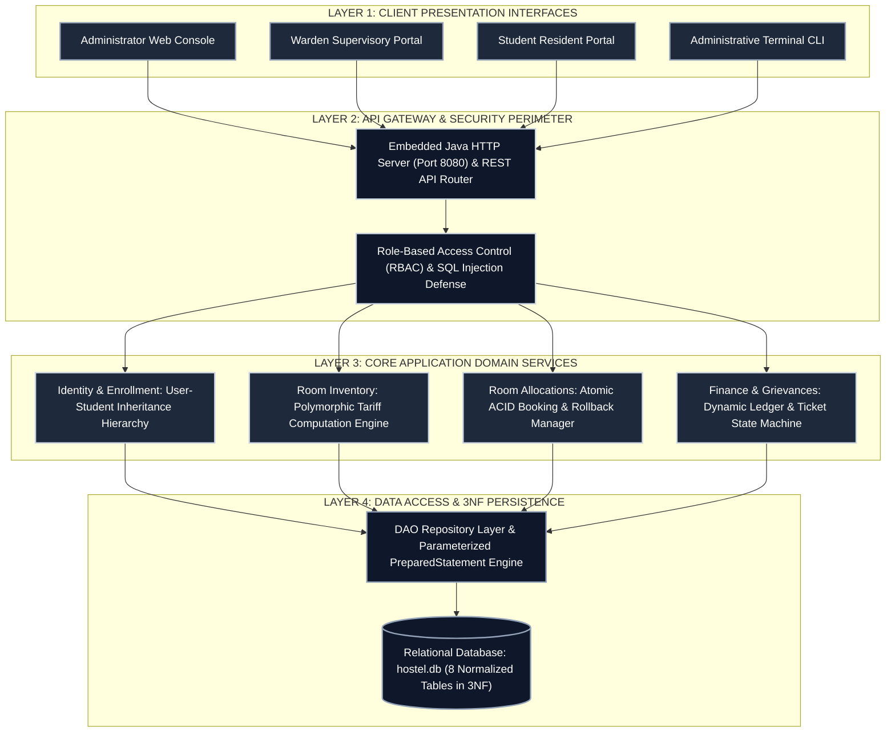

# SMARTHOSTEL: CLEAN ENTERPRISE SYSTEM ARCHITECTURE
## Spacious 4-Tier Architectural Topology & Subsystem Interaction Model

---

### 1. Spaced & High-Contrast System Architecture Diagram (Mermaid)

---

### 2. Tier Breakdown for Slide & Viva

* **Layer 1: Client Presentation Interfaces:** Tailored access points for all user roles (Administrator, Warden, and Student) across responsive Single Page Web Dashboards and a headless Terminal CLI.
* **Layer 2: API Gateway & Security Perimeter:** Centralized ingress running on an embedded Java HTTP server (Port 8080) providing REST routing, RBAC authorization, and parameterized SQL injection prevention.
* **Layer 3: Core Application Domain Services:** The core Java business tier encapsulating object-oriented design: class inheritance (`User` $\to$ `Student`), dynamic method overriding for room tariffs, atomic ACID transaction boundaries with rollback guarantees, dynamic payment ledger aggregations, and complaint lifecycles.
* **Layer 4: Data Access & 3NF Persistence:** Data Access Object (DAO) pattern using JDBC `PreparedStatement` to ensure data integrity across an 8-table Third Normal Form (3NF) relational database.
