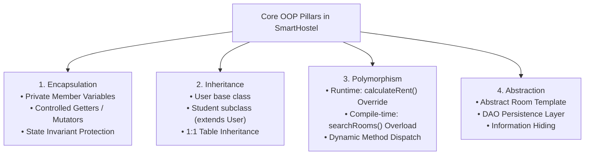

# SMARTHOSTEL: JAVA & OBJECT-ORIENTED PROGRAMMING PRINCIPLES GUIDE
## Comprehensive Academic & Viva Voce Guide: Applied Concepts, Architecture Inferences & Defense Answers

This guide explains all Java, Object-Oriented Programming (OOP), and Software Engineering principles implemented in **SmartHostel**. It is structured specifically for academic examinations, project reviews, and viva-voce defense.

---

## 🏛️ PART 1: THE FOUR PILLARS OF OOP APPLIED



---

### 1. Encapsulation (Data Hiding & State Integrity)

#### Concept Definition:
Encapsulation binds data (attributes) and methods (behavior) together within a single class while restricting direct access to the internal state from outside the class.

#### How We Applied It:
1. **Private Attribute Visibility:** In classes like `User`, `Student`, and `Room`, all core instance variables (`userId`, `username`, `password`, `capacity`, `bedsOccupied`, `baseRent`, `regNo`, `phone`) are declared `private`.
2. **Controlled Accessors:** Access to internal attributes is provided strictly through public getter methods (`getUserId()`, `getRoomNo()`, `getCapacity()`, etc.).
3. **State Invariant Guards:** Critical domain rules cannot be bypassed by external code. For example, bed availability is checked via the domain method `hasVacancy()` (`bedsOccupied < capacity`) rather than allowing external callers to directly mutate the integer counter.

#### Software Engineering Inference / Benefit:
* **Tamper-Proof State:** Prevents illegal memory states (e.g., negative room occupancy or base rents below ₹0).
* **Maintainability:** Internal data structures can be refactored without breaking external consumer classes.

#### 🎙️ Viva Defense Answer:
> *"We implemented encapsulation across all our domain entities. In our Room and User classes, all attributes are marked `private`. External modules cannot arbitrarily manipulate bed occupancy or user credentials; they must interact through public accessor methods and validated domain primitives like `hasVacancy()`. This prevents state corruption in memory."*

---

### 2. Inheritance (Hierarchical Code Reusability)

#### Concept Definition:
Inheritance allows a new class (subclass/derived class) to acquire attributes and behaviors from an existing class (superclass/base class), establishing an `"is-a"` relationship.

#### How We Applied It:
1. **`User` $\to$ `Student` Class Hierarchy:**
   * **Base Class (`User`):** Encapsulates core authentication credentials common to all actors: `userId`, `username`, `password`, `role`, and `fullName`.
   * **Derived Subclass (`Student extends User`):** Inherits all security fields from `User` while adding student-specific academic attributes: `regNo`, `gender`, `department`, and `phone`.
2. **Constructor Chaining (`super`):** The `Student` constructor explicitly chains to the parent constructor using `super(userId, username, password, "STUDENT", fullName);`, enforcing correct initialization order.
3. **Relational Reflection:** This OOP inheritance hierarchy is mapped directly into our Third Normal Form (3NF) relational database via 1-to-1 table inheritance: `students.student_id` acts as both the Primary Key and Foreign Key referencing `users.user_id` with `ON DELETE CASCADE`.

#### Software Engineering Inference / Benefit:
* **Elimination of Redundant Code:** Authentication and identity logic is written once in `User` and inherited by `Student`.
* **Polymorphic Substitutability:** Any method accepting a `User` reference can seamlessly accept a `Student` object (Liskov Substitution Principle).

#### 🎙️ Viva Defense Answer:
> *"We applied class inheritance by establishing a `User` superclass that holds authentication attributes (`userId`, `username`, `role`), which is extended by our `Student` subclass. `Student` reuses the parent's constructor using `super(...)` and adds academic fields like `regNo` and `department`. This OOP relationship is mirrored in our database via 1:1 table specialization between `users` and `students`."*

---

### 3. Polymorphism (Flexibility & Dynamic Behavior)

Polymorphism allows one interface to be used for a general class of actions. We implemented **both forms**:

#### A. Runtime Polymorphism (Dynamic Method Overriding)
* **Implementation:**
  * The base abstract class `Room` declares the abstract method:
    $$\text{public abstract double calculateRent();}$$
  * Three concrete subclasses override `calculateRent()` with category-specific business rules:
    * **`StandardRoom`:** Returns the base monthly rent ($1.0 \times \text{baseRent}$).
    * **`DeluxeRoom`:** Returns base rent plus a 15% amenities surcharge ($\text{baseRent} \times 1.15$).
    * **`ACRoom`:** Returns base rent plus a 35% HVAC electricity surcharge ($\text{baseRent} \times 1.35$).
* **Dynamic Dispatch at Runtime:**
  In `BillingAndComplaintModule`, when calculating semester dues for an allocated resident:
  $$\text{dues} = (\text{room.calculateRent()} \times 6) + 15000.00$$
  The JVM dynamically resolves the appropriate `calculateRent()` method based on whether the actual runtime object is a `StandardRoom`, `DeluxeRoom`, or `ACRoom`.
* **Benefit:** Eliminates clumsy and brittle `switch(roomType)` or `if-else` blocks throughout the billing system.

#### B. Compile-Time Polymorphism (Method Overloading)
* **Implementation:**
  In `RoomModule`, the search functionality is overloaded with identical method names but differing parameter type signatures:
  1. `searchRooms(int minCapacity)`: Filters rooms providing at least $N$ bed spaces.
  2. `searchRooms(String roomType)`: Filters rooms matching a specific category string (`"STANDARD"`, `"DELUXE"`, `"AC"`).
* **Benefit:** Provides a clean, intuitive API for callers while letting the Java compiler bind the correct method signature at compile time.

#### 🎙️ Viva Defense Answer:
> *"We demonstrated both runtime and compile-time polymorphism. For runtime polymorphism, our abstract `Room` class defines `calculateRent()`, which is overridden dynamically by `StandardRoom` (1.0x), `DeluxeRoom` (1.15x), and `ACRoom` (1.35x). When the billing module calculates semester dues, it invokes `room.calculateRent()` polymorphically without knowing the concrete subtype. For compile-time polymorphism, we overloaded `searchRooms()` to support filtering either by bed capacity (integer) or room type (string)."*

---

### 4. Abstraction (Hiding Complexity Behind Clean Interfaces)

#### Concept Definition:
Abstraction focuses on presenting essential features to the outside world while hiding the internal implementation complexity.

#### How We Applied It:
1. **Abstract Base Class (`abstract class Room`):**
   * Declares the essential contract for what every hostel room must do without dictating how specific tariff surcharges are calculated.
   * Prevents direct instantiation of a generic room (`new Room()` is prohibited by the compiler). Only concrete, specialized rooms (`StandardRoom`, `DeluxeRoom`, `ACRoom`) can be instantiated.
2. **Data Access Layer Abstraction:**
   * Business service callers invoke clean domain methods like `allocMod.allocateRoom(studentId, roomId)` without writing SQL `INSERT` statements, opening database sockets, or managing connection pools.

#### Software Engineering Inference / Benefit:
* **Decoupling:** High-level business logic is shielded from low-level database driver details.
* **Extensibility:** Adding a new room type requires only subclassing `Room` and implementing `calculateRent()`.

#### 🎙️ Viva Defense Answer:
> *"We applied abstraction using an abstract base class `Room` that defines common attributes and abstract behaviors while preventing generic room creation. The caller interacts solely with the abstract contract, completely unaware of internal surcharge multipliers. Furthermore, our DAO layer abstracts complex SQL joins and JDBC transaction handling away from the presentation views."*

---

## 🏗️ PART 2: SOFTWARE DESIGN PATTERNS APPLIED

| Design Pattern | Category | Project Implementation | Architectural Benefit |
| :--- | :--- | :--- | :--- |
| **DAO Pattern** | Structural / Integration | `StudentModule`, `RoomModule`, `AllocationModule`, `BillingAndComplaintModule` | Segregates SQL queries and JDBC operations from domain models and UI controllers. |
| **Singleton Pattern** | Creational | `Database.getConnection()` | Centralizes database connection management, avoiding connection thrashing and resource exhaustion. |
| **Factory Method Pattern** | Creational | `RoomModule.createRoomInstance(...)` | Dynamically instantiates the correct concrete room class (`StandardRoom`, `DeluxeRoom`, `ACRoom`) based on the database column `room_type`. |
| **MVC Pattern** | Architectural | Models (`User`, `Room`), Views (Web SPA, CLI), Controllers (`WebServer` handlers) | Separates presentation state from business rules and persistent relational storage. |

---

## ⚡ PART 3: ADVANCED JAVA & ENTERPRISE MECHANISMS

### 1. Robust Resource Management (`try-with-resources`)
* All JDBC interactions use Java's `try (PreparedStatement ps = ...; ResultSet rs = ...)` syntax.
* **Benefit:** Guarantees automatic invocation of `.close()` on statements and result sets even if an exception occurs, eliminating database cursor leaks.

### 2. ACID Transaction Boundaries via JDBC
* Multi-table operations (e.g., student room allocation, student deregistration) explicitly disable auto-commit:
  ```java
  conn.setAutoCommit(false); // Begin ACID transaction
  // ... coordinated multi-table queries ...
  conn.commit();             // Atomically commit changes
  ```
* If any SQL constraint fails (e.g., capacity violation), the `catch` block invokes `conn.rollback()`, ensuring zero database corruption.

### 3. Protection Against SQL Injection (`PreparedStatement`)
* Instead of concatenating user strings into SQL queries, every query uses parameterized placeholders (`?`):
  ```java
  ps.setString(1, username);
  ps.setString(2, password);
  ```
* **Benefit:** The database engine treats inputs strictly as literal values, completely neutralizing SQL injection attacks.

---

## ❓ TOP 10 VIVA VOCE QUESTIONS & MODEL ANSWERS

#### Q1: Where have you used Polymorphism in your code?
> **Answer:** In our tariff engine. The abstract class `Room` defines `calculateRent()`. The concrete subclasses `StandardRoom`, `DeluxeRoom`, and `ACRoom` override this method to add 0%, 15%, and 35% surcharges respectively. When billing a student, calling `room.calculateRent()` dynamically dispatches to the correct subclass at runtime. We also used compile-time polymorphism by overloading `searchRooms(int capacity)` and `searchRooms(String type)`.

#### Q2: What is the difference between an Abstract Class and an Interface, and why did you choose an Abstract Class for `Room`?
> **Answer:** An interface defines only pure method contracts (or default methods) without instance state, whereas an abstract class can maintain common instance fields (`roomId`, `blockId`, `capacity`, `bedsOccupied`, `baseRent`) and concrete helper methods (`hasVacancy()`). We chose an abstract class because all rooms share common physical inventory attributes and bed validation logic, but differ only in their rent calculation formula.

#### Q3: How did you implement Encapsulation, and what happens if someone tries to bypass it?
> **Answer:** All instance variables across our model classes are marked `private`. External classes cannot directly assign values to `bedsOccupied` or `password`. They must use public getters or domain methods. If an external class attempts to directly read or modify private fields, the Java compiler will flag a compilation error, preserving state invariants.

#### Q4: Why did you extend `Student` from `User` instead of keeping them separate?
> **Answer:** This reflects the real-world `"is-a"` relationship: every student is an authenticated system user. By extending `User`, `Student` inherits credentials and role checking logic without code duplication, while adding university registration attributes. In our database, this is modeled as 1-to-1 table inheritance with foreign key cascades.

#### Q5: What is the Factory Method pattern, and where is it used?
> **Answer:** The Factory Method pattern delegates object instantiation to a specialized method rather than calling constructors directly with `new`. In `RoomModule.createRoomInstance()`, the method examines the `room_type` string retrieved from the database and instantiates the correct subclass (`StandardRoom`, `DeluxeRoom`, or `ACRoom`).

#### Q6: How does your code prevent SQL injection?
> **Answer:** We exclusively use `java.sql.PreparedStatement` with typed parameter markers (`?`). We never use raw `Statement` with string concatenation (`"WHERE user = '" + u + "'"`). This ensures the RDBMS parses the query structure first and treats user parameters strictly as data literals.

#### Q7: What is the Singleton pattern, and why was it necessary for `Database`?
> **Answer:** The Singleton pattern ensures that only one instance of a class exists throughout the application lifecycle. Our `Database.getConnection()` method maintains a single static `Connection` object initialized once. This prevents opening multiple redundant file locks on the SQLite database, eliminating connection thrashing.

#### Q8: How does your code guarantee ACID properties during room booking?
> **Answer:** In `AllocationModule`, we set `conn.setAutoCommit(false)`. We verify that the student is unallocated and that `beds_occupied < capacity`. We then execute two SQL statements: inserting the allocation row and incrementing `beds_occupied` in the room table. Finally, we execute `conn.commit()`. If an exception occurs, `conn.rollback()` restores the database to its exact prior state.

#### Q9: What is dynamic method dispatch in Java?
> **Answer:** Dynamic method dispatch is the mechanism by which a call to an overridden method is resolved at runtime rather than compile time. In our billing module, a variable of type `Room` holds an instance of `ACRoom`. When `room.calculateRent()` is called, the JVM looks at the actual runtime object and executes `ACRoom`'s implementation.

#### Q10: How does your architecture satisfy the Open/Closed Principle (OCP)?
> **Answer:** The Open/Closed Principle states that software entities should be open for extension but closed for modification. If our hostel introduces a new room category (e.g., `ExecutiveSuite`), we simply create a new class `ExecutiveSuite extends Room` and implement `calculateRent()`. We do not need to modify the existing `Room`, `AllocationModule`, or `BillingAndComplaintModule` classes.
